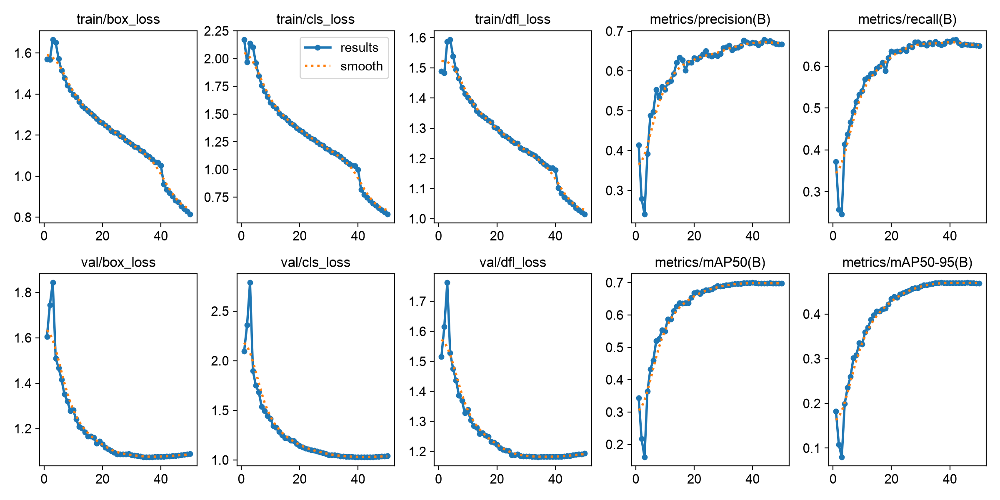
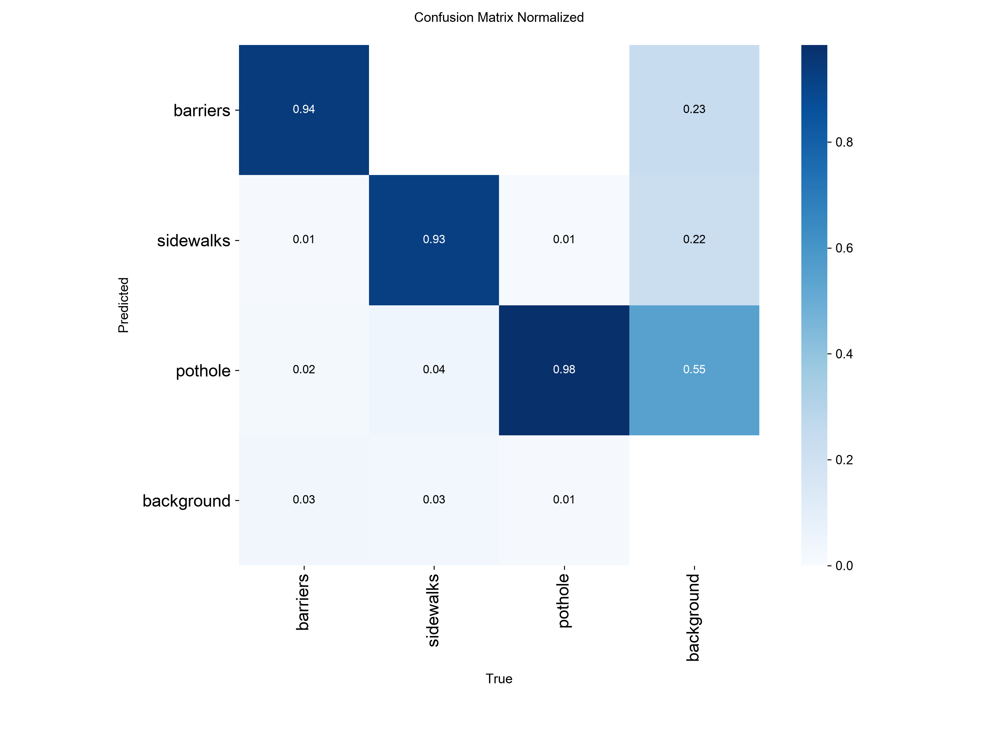
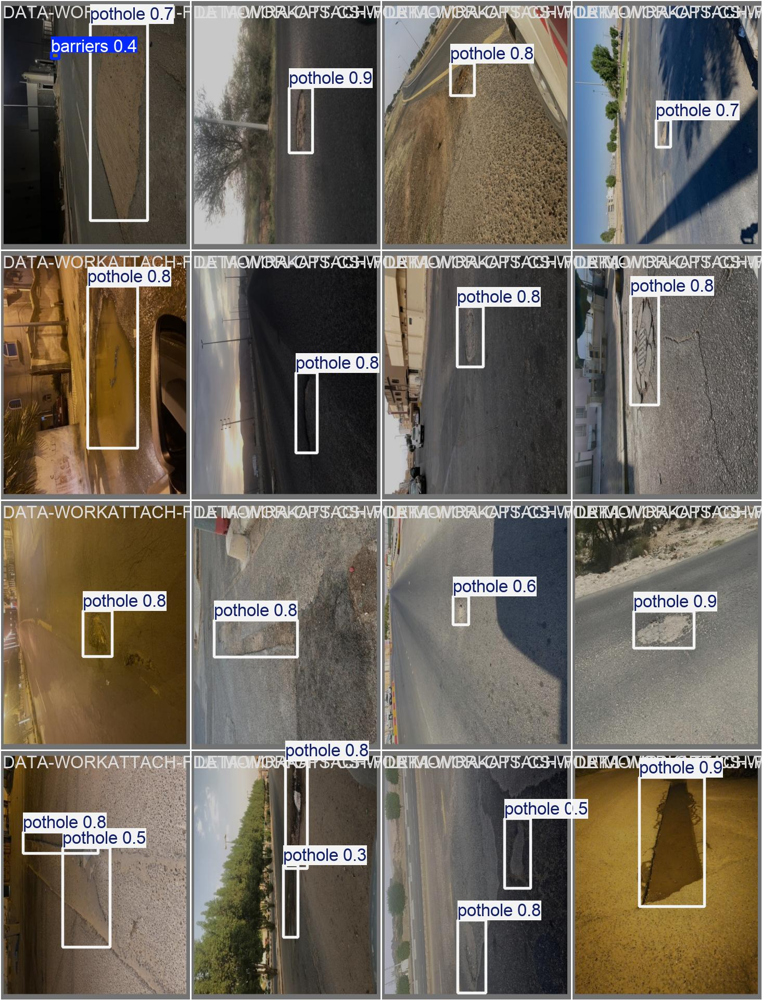
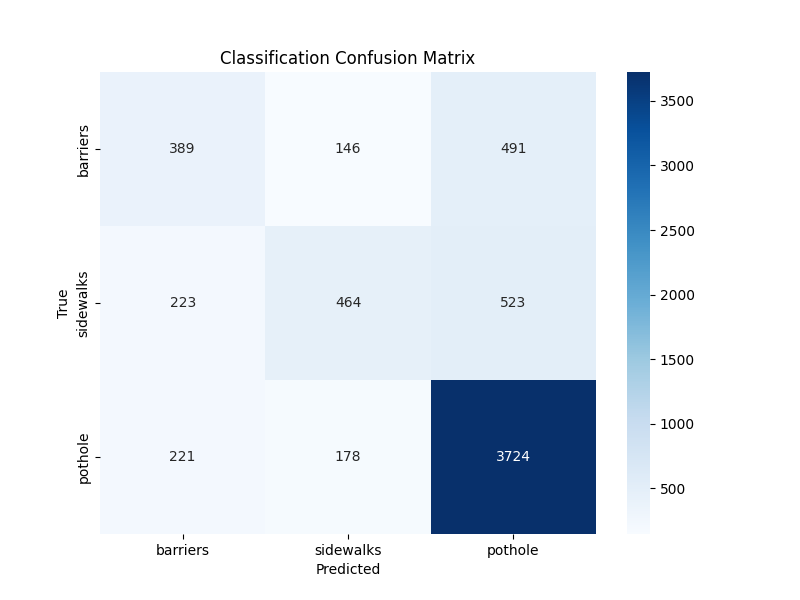
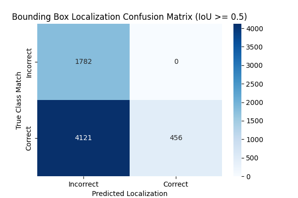
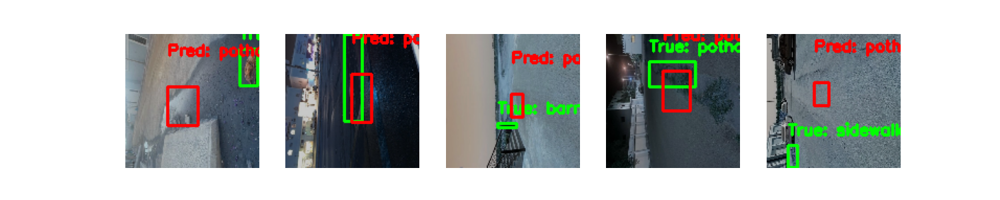

# Visual-Pollution-Saudi-Roads

> **Status: v1 released, work in progress.** v1 is a real YOLO11s detector trained and tested on leak-free splits. The first baseline (v0) is kept below for reference, with its corrected numbers. The next phase is in [`docs/PLAN.md`](docs/PLAN.md).

## Overview

This project detects three types of visual pollution in images of Saudi public roads: **barriers**, **sidewalks** (dilapidated sidewalks) and **potholes**.

| Version | Model | Evaluation | Headline |
|---|---|---|---|
| **v1** | Ultralytics YOLO11s, 640 px, all objects per image | Held-out test split, grouped by incident, no duplicates | **mAP50 0.699, mAP50-95 0.473** |
| v0 | Small custom CNN (YOLO-inspired, not YOLO), one box per image | Random split also used for early stopping (leaky) | Accuracy 0.720, mean IoU 0.166 |

## Results (v1, YOLO11s)

**Setup:**
- Model: YOLO11s with COCO-pretrained weights, input 640 px.
- Training: 50 epochs, batch 16, seed 42, default Ultralytics augmentation.
- Hardware: Apple M5 Pro (MPS), about 13 min per epoch.
- Best checkpoint: epoch 46. Validation mAP was still rising at the end, so longer training should help.
- Script: [`src/train.py`](src/train.py). Full outputs: [`reports/yolo11s_640_v1`](reports/yolo11s_640_v1).

**Test split** (3,053 images, never seen in training or model selection):

| Class | Precision | Recall | mAP50 | mAP50-95 |
|---|---|---|---|---|
| barriers | 0.627 | 0.637 | 0.657 | 0.491 |
| sidewalks | 0.604 | 0.619 | 0.643 | 0.382 |
| pothole | 0.714 | 0.734 | 0.797 | 0.546 |
| **all** | **0.649** | **0.663** | **0.699** | **0.473** |

**Errors and speed:**
- Once an object is detected, the class is usually right: the confusion-matrix diagonal is 0.94 (barriers), 0.93 (sidewalks) and 0.98 (pothole).
- Most errors are **false alarms on background**. 55% of them are predicted as potholes.
- Speed: about 5 ms per image in batches of 16 on the M5 Pro (0.4 ms inference + 4.5 ms NMS).







### Comparison with the dataset paper

The dataset paper ([AlElaiwi et al., 2022, *Mathematics* 11(1):186](https://doi.org/10.3390/math11010186)) reports:
- 89% precision, 88% recall, 89% F1 and 93% mAP, using YOLOv5x;
- 70% mAP when re-tested on an external pothole dataset.

The two protocols differ:

| | Paper | This repo (v1) |
|---|---|---|
| Split | Random per class, 70/10/20, image level | Grouped by incident ticket, exact duplicates removed, 80/10/10 |
| Labels | Mostly generated by deep active learning from 1,200 hand-labelled images | The released labels, as published |
| Model | YOLOv5x, 100–250 epochs, hyperparameter evolution | YOLO11s, 50 epochs, defaults |
| mAP type | Not stated | mAP50 and mAP50-95 |

The headline numbers are **not directly comparable**. The [data audit](reports/data_audit/report.md) found that, in the official split, 16% of val images are exact copies of train images. A random image-level split puts copies and photos of the same incident in both train and test. The next phase measures how much a random split inflates **this** model's score (see [`docs/PLAN.md`](docs/PLAN.md), Track A).

## Reproduce v1

```bash
pip install -r requirements-train.txt
python src/make_splits.py --data "<dataset root>" --install
python src/train.py --data "<dataset root>/data_v1.yaml"
```

The trained weights (`best.pt`, 18 MB) are not in the repository yet. They will be published with the next release.

## Dataset

The data is the **Saudi Arabia Public Roads Visual Pollution Dataset** by AlElaiwi et al. (2022), published on Mendeley Data under the **CC BY 4.0** license. This project uses the dataset as published. The annotations are the dataset authors' work.

- Download: https://data.mendeley.com/datasets/bb7b8vtwry/1
- Classes used here: `barriers`, `sidewalks`, `pothole`
- **The official train/val split leaks.** 1,158 val images (16%) are byte-identical copies of train images, and 1,648 incident tickets have photos in both splits. See the [data audit](reports/data_audit/report.md).
- **New splits (v1):** after removing 1,271 exact duplicates, the 30,524 unique images are split 80/10/10 by incident ticket, so no incident appears in two splits. Lists are in [`splits/`](splits/summary.md) and are rebuilt with `python src/make_splits.py --data <root> --install`.
- Images in the downloaded copy: 31,795, holding 41,804 labelled objects. The v0 notebook kept only the first object per label file, so it dropped 23.9% of the objects. v1 uses all of them.

```
AlElaiwi, M., Ahmad, H., Hussain, J., Al-antari, M., Almarri, B., & Azhar, A. (2022).
Saudi Arabia Public Roads Visual Pollution Dataset (Version 1) [Data set]. Mendeley Data.
https://doi.org/10.17632/bb7b8vtwry.1 — Licensed under CC BY 4.0
```

## Baseline model (v0, superseded)

- **Input:** images resized to 128×128 without keeping the aspect ratio
- **Backbone:** 3 × (Conv2D + MaxPooling)
- **Heads:**
  - a softmax head for the class
  - a sigmoid head for one box `[cx, cy, w, h]`
- **Losses:**
  - focal loss (γ=2, α=0.25) for the class
  - MSE for the box
- **Training:**
  - Adam (lr=1e-4), batch size 8
  - early stopping on the class loss (stopped at epoch 22, best weights from epoch 17)

## Results (v0, corrected)

Evaluated on a random 20% split of train+val (6,359 images).

> ⚠️ This split was also used for early stopping, so these numbers are **optimistic**. There is no independent test set yet.

### Classification

| Class | Precision | Recall | F1 |
|---|---|---|---|
| barriers | 0.467 | 0.379 | 0.419 |
| sidewalks | 0.589 | 0.384 | 0.465 |
| pothole | 0.786 | 0.903 | 0.841 |

- **Accuracy:** 0.720.
- **Majority-class baseline:** always predicting `pothole` would score about 0.648 on this split.



Barriers and sidewalks are most often predicted as potholes, which is also the dominant class (about 64% of images).

### Localization

| Metric | Value |
|---|---|
| Mean IoU | 0.166 |
| IoU ≥ 0.5 | 8.1% |
| IoU ≥ 0.75 | 0.6% |
| Mean absolute error of box coordinates | 0.124 |



**How to read this matrix** (rows: is the class correct? columns: is the box correct, IoU ≥ 0.5?):

| | Box correct | Box incorrect |
|---|---|---|
| **Class correct** | **456 (7.2%)**: fully correct detections | 4,121: right class, wrong box |
| **Class incorrect** | 0 | 1,782: wrong class and wrong box |

Only **456 of 6,359** test images (7.2%) have both the right class and a box with IoU ≥ 0.5.

> An earlier version of this README labelled 1,782 as "true positives", 456 as "false positives" and 4,121 as "false negatives". That reading was wrong.

> The code that produced this matrix is not in the notebook. Its total of 456 boxes with IoU ≥ 0.5 also differs from the notebook's printed 8.1% (about 514). It will be regenerated in the next version.

### Sample predictions



Green boxes are the ground truth, red boxes the predictions. Known display issues in this figure:

- Colours are swapped: the image is OpenCV BGR shown as RGB.
- Some labels are cut off at the image edge.

## Known issues in v0

1. **Not a YOLO detector.** The model predicts one box per image. Every label line after the first is discarded.
2. **Augmentation corrupts boxes.** Flips, shifts, rotation and zoom are applied to the images, but the box coordinates are not transformed with them. This is a major cause of the low IoU.
3. **Evaluation leakage.** Train and val were merged and re-split at random, and the "test" split was used for early stopping.
4. **Class imbalance is not addressed.** Focal loss uses one α for all classes, and no class weighting is applied.
5. **Low resolution.** Resizing to 128×128 without keeping the aspect ratio makes small barriers and sidewalks hard to see.
6. **Not reproducible.**
   - Paths are hard-coded to Google Drive.
   - There is no `requirements.txt`.
   - The trained weights are not published.
   - Training is forced onto the CPU.

## Roadmap

1. ~~**Audit the data.**~~ Done: [`reports/data_audit`](reports/data_audit/report.md).
2. ~~**Fix the evaluation.**~~ Done: leak-free v1 splits by incident ticket in [`splits/`](splits/summary.md).
3. ~~**Retrain with a real detector.**~~ Done: YOLO11s, results above. The v0 model cannot be re-evaluated on the new test split because its weights were never saved.
4. **Next phase:** see [`docs/PLAN.md`](docs/PLAN.md). It covers:
   - pre-processing of train and val (quality filter, near-duplicates, label review);
   - measuring the random-split inflation;
   - higher resolution and longer training;
   - released weights and a demo.

## Contributions

Issues and pull requests are welcome.

## License

Code: [MIT](LICENSE). The images and labels follow the license of the original dataset (AlElaiwi et al., 2022).
