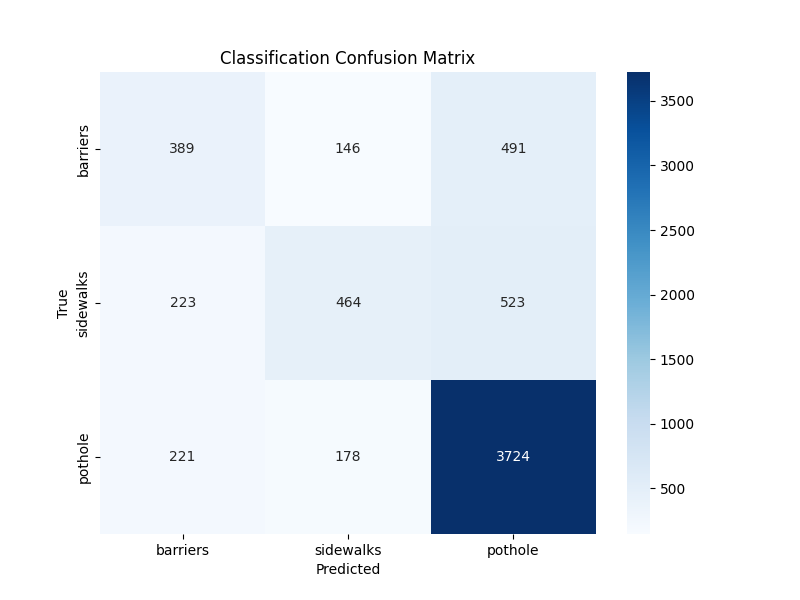
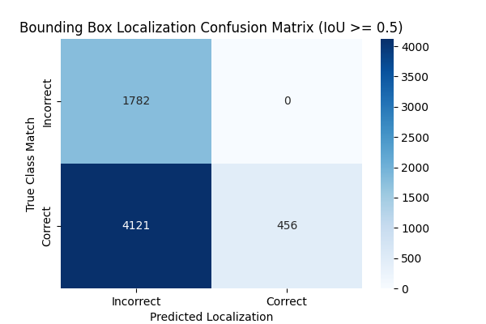
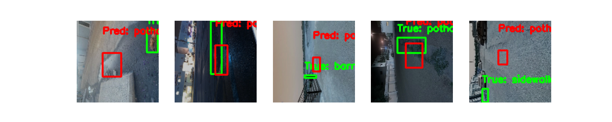

# v0 baseline (superseded)

The first version of this project: a small custom CNN, kept for reference with its corrected numbers. v1 replaced it.

## Model

- **Input:** images resized to 128×128 without keeping the aspect ratio
- **Backbone:** 3 × (Conv2D + MaxPooling)
- **Heads:**
  - a softmax head for the class
  - a sigmoid head for one box `[cx, cy, w, h]`
- **Losses:**
  - focal loss (γ=2, α=0.25) for the class
  - MSE for the box
- **Training:**
  - Adam (lr=1e-4), batch size 8
  - early stopping on the class loss (stopped at epoch 22, best weights from epoch 17)

## Results (corrected)

Evaluated on a random 20% split of train+val (6,359 images).

> ⚠️ This split was also used for early stopping, so these numbers are **optimistic**. There is no independent test set yet.

### Classification

| Class | Precision | Recall | F1 |
|---|---|---|---|
| barriers | 0.467 | 0.379 | 0.419 |
| sidewalks | 0.589 | 0.384 | 0.465 |
| pothole | 0.786 | 0.903 | 0.841 |

- **Accuracy:** 0.720.
- **Majority-class baseline:** always predicting `pothole` would score about 0.648 on this split.

Barriers and sidewalks are most often predicted as potholes, which is also the dominant class (about 64% of images).

### Localization

| Metric | Value |
|---|---|
| Mean IoU | 0.166 |
| IoU ≥ 0.5 | 8.1% |
| IoU ≥ 0.75 | 0.6% |
| Mean absolute error of box coordinates | 0.124 |

**How to read this matrix** (rows: is the class correct? columns: is the box correct, IoU ≥ 0.5?):

| | Box correct | Box incorrect |
|---|---|---|
| **Class correct** | **456 (7.2%)**: fully correct detections | 4,121: right class, wrong box |
| **Class incorrect** | 0 | 1,782: wrong class and wrong box |

Only **456 of 6,359** test images (7.2%) have both the right class and a box with IoU ≥ 0.5.

> An earlier version of this README labelled 1,782 as "true positives", 456 as "false positives" and 4,121 as "false negatives". That reading was wrong.

> The code that produced this matrix is not in the notebook. Its total of 456 boxes with IoU ≥ 0.5 also differs from the notebook's printed 8.1% (about 514). It will be regenerated in the next version.

### Sample predictions

Green boxes are the ground truth, red boxes the predictions. Known display issues in this figure:

- Colours are swapped: the image is OpenCV BGR shown as RGB.
- Some labels are cut off at the image edge.

## Known issues

1. **Not a YOLO detector.** The model predicts one box per image. Every label line after the first is discarded.
2. **Augmentation corrupts boxes.** Flips, shifts, rotation and zoom are applied to the images, but the box coordinates are not transformed with them. This is a major cause of the low IoU.
3. **Evaluation leakage.** Train and val were merged and re-split at random, and the "test" split was used for early stopping.
4. **Class imbalance is not addressed.** Focal loss uses one α for all classes, and no class weighting is applied.
5. **Low resolution.** Resizing to 128×128 without keeping the aspect ratio makes small barriers and sidewalks hard to see.
6. **Not reproducible.**
   - Paths are hard-coded to Google Drive.
   - There is no `requirements.txt`.
   - The trained weights are not published.
   - Training is forced onto the CPU.
