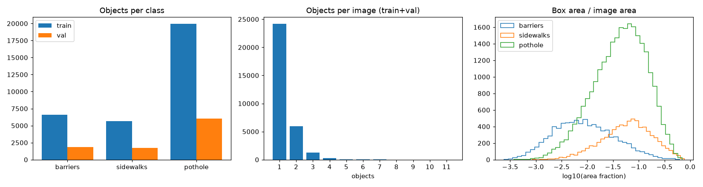

# Data audit report

## Files and label integrity

| | train | val |
|---|---|---|
| Images | 24,553 | 7,242 |
| Label files | 24,553 | 7,242 |
| Images without a label file | 0 | 0 |
| Label files without an image | 0 | 0 |
| Empty label files | 0 | 0 |
| Label files with problems | 0 | 0 |
| Unreadable images | 0 | 0 |

## Class balance

| Class | train objects | val objects | images containing it (train+val) |
|---|---|---|---|
| barriers | 6,579 | 1,838 | 6,322 |
| sidewalks | 5,663 | 1,749 | 6,709 |
| pothole | 19,960 | 6,015 | 21,429 |

Total objects: **41,804** in 31,795 labelled images.

## Objects per image

- Images with more than one object: **7,600** (23.9%)
- Objects the v0 notebook discards by keeping only the first line: **10,009** (23.9% of all objects)

## Box sizes (area as a fraction of the image)

| Class | tiny <0.5% | small 0.5-2% | medium 2-10% | large >=10% | median |
|---|---|---|---|---|---|
| barriers | 36.6% | 36.3% | 22.7% | 4.3% | 0.81% |
| sidewalks | 2.1% | 15.0% | 50.0% | 32.9% | 6.40% |
| pothole | 4.6% | 20.9% | 48.4% | 26.0% | 4.78% |

At 128×128 input, a box under 0.5% of the image is smaller than about 9×9 pixels.

## Image sizes and EXIF orientation

- **train** most common sizes: 460x600 (16,457), 450x600 (8,096)
- **val** most common sizes: 460x600 (4,776), 450x600 (2,466)
- **train** EXIF orientation: 1: 24,553 → rotated/flipped flag on **0** images (0.0%)
- **val** EXIF orientation: 1: 7,242 → rotated/flipped flag on **0** images (0.0%)

Orientation 1 means no rotation. Any other value means the viewer rotates the image, so labels may not match what libraries that ignore EXIF (or that apply it) see. Check a sample by eye before training.

## Exact duplicates (identical file bytes)

- **Val images that also appear in train: 1,158** (16.0% of val). Listed in `exact_duplicates_val_train.txt`.
- Extra copies within train: 104; within val: 14
- Unique images across both splits: **30,524** of 31,795

## Near-duplicate candidates (dHash, Hamming distance ≤ 2)

Includes the exact duplicates above. Dark or blurry photos can match by chance, so treat these as candidates and check a sample by eye.

- Within train: **12,236** pairs
- Within val: **842** pairs
- **Across train and val: 7,608 pairs**, involving 1,574 val images (21.7%)

## Incident tickets shared between splits

File names contain an incident id (`INC-YY-MM-NNNNNN`); one incident usually has several photos of the same spot.

- Incidents in train: 22,600; in val: 6,969
- Images without an incident id: 0
- **Incidents present in both splits: 1,648**, covering 1,872 val images (25.8%)
- Photos per incident: median 1, max 16

## Figures

